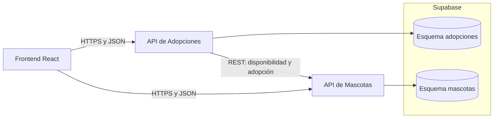
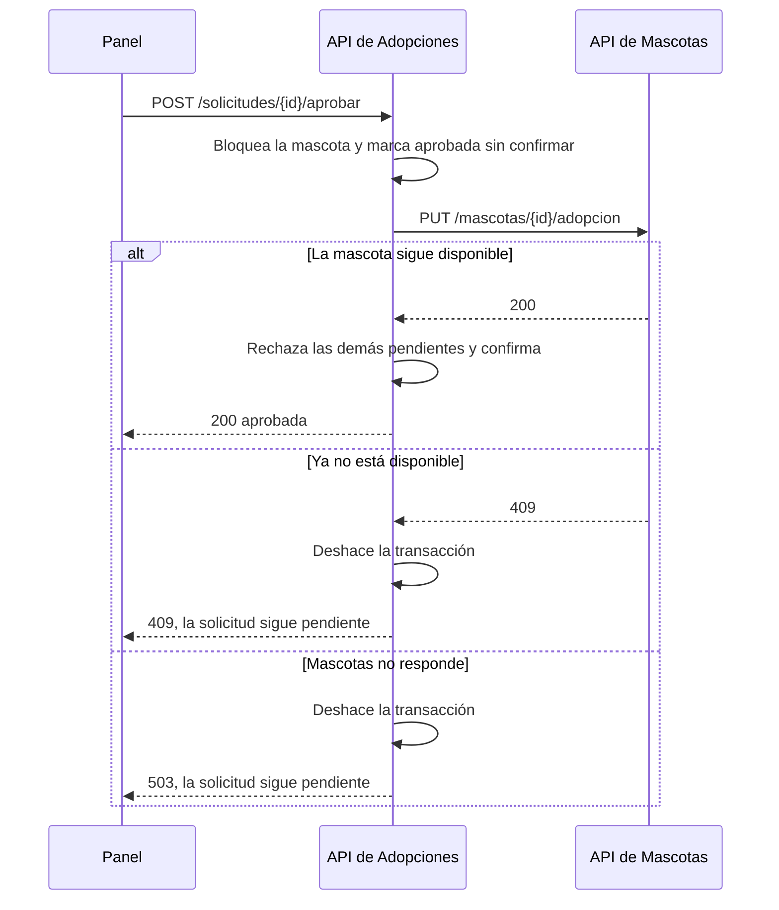

# Pawsible

Plataforma web de adopción de mascotas para la Fundación Huellas de Esperanza. Dos APIs FastAPI independientes se comunican por HTTP/REST para llevar el proceso completo: consultar una mascota, verificar su disponibilidad, registrar una solicitud, aprobarla o rechazarla y actualizar el estado en ambos servicios.

Una mascota nunca queda con dos adopciones aprobadas. Lo garantizan un `UPDATE` condicional en la API de Mascotas, un bloqueo por mascota en la API de Adopciones y un índice único parcial en la base de datos.

## Despliegue

| Componente | URL |
| --- | --- |
| Plataforma web | [pawsible-two.vercel.app](https://pawsible-two.vercel.app) |
| API de Mascotas (Swagger) | [pawsible-mascotas.vercel.app/docs](https://pawsible-mascotas.vercel.app/docs) |
| API de Adopciones (Swagger) | [pawsible-adopciones.vercel.app/docs](https://pawsible-adopciones.vercel.app/docs) |

La base de datos está en Supabase. El panel de la fundación (`/panel`) pide la clave `ADMIN_API_KEY`, que no se publica en este repositorio.

## Arquitectura



Cada servicio usa un rol de Postgres que solo tiene permiso sobre su esquema, de modo que Adopciones llega a los datos de Mascotas únicamente por la API.

### Aprobación de una solicitud



Si la base local falla al confirmar después de marcar la mascota, Adopciones llama a `DELETE /mascotas/{id}/adopcion` para compensar. El `PUT` es idempotente por `solicitud_id`, así que reintentar es seguro.

## Estructura

```text
services/mascotas     API de Mascotas
services/adopciones   API de Adopciones
frontend              React, Vite y pruebas Playwright
supabase/migrations   Esquemas, roles y datos iniciales
tests/integration     Pruebas entre servicios
docs/evidencias       Reportes y capturas de las pruebas
```

## Endpoints

| API | Método y ruta | Acceso |
| --- | --- | --- |
| Mascotas | `GET /mascotas`, `GET /mascotas/{id}`, `GET /mascotas/{id}/disponibilidad` | Público |
| Mascotas | `POST /mascotas`, `PATCH /mascotas/{id}` | `X-Admin-Key` |
| Mascotas | `PUT` y `DELETE /mascotas/{id}/adopcion` | `X-Service-Key` |
| Adopciones | `POST /solicitudes`, `GET /solicitudes/{id}` | Público (el código es un UUID) |
| Adopciones | `GET /solicitudes`, `POST /solicitudes/{id}/aprobar`, `POST /solicitudes/{id}/rechazar` | `X-Admin-Key` |

Cada API publica Swagger en `/docs` y el contrato OpenAPI en `/openapi.json`.

## Ejecutar en local

Requiere Docker, Python 3.12 con [uv](https://docs.astral.sh/uv/) y Node 20 o superior.

```bash
# Base de datos con las migraciones aplicadas
scripts/db-local.sh        # o: docker compose up -d --wait db

# Dependencias de Python
uv venv --python 3.12 .venv
uv pip install --python .venv/bin/python -r tests/requirements.txt

# API de Mascotas, en una terminal (puerto 8001)
cd services/mascotas && cp .env.example .env
../../.venv/bin/uvicorn app.main:app --port 8001

# API de Adopciones, en otra terminal (puerto 8002)
cd services/adopciones && cp .env.example .env
../../.venv/bin/uvicorn app.main:app --port 8002

# Frontend, en otra terminal
cd frontend && cp .env.example .env && npm install && npm run dev
```

Las claves de `.env.example` necesitan 16 caracteres o más y deben ser iguales en los dos servicios. La clave `ADMIN_API_KEY` es la que pide el panel de la fundación.

## Pruebas

```bash
scripts/db-local.sh --reset
.venv/bin/python -m pytest tests/integration --junitxml=docs/evidencias/integracion.xml
(cd services/adopciones && ../../.venv/bin/python -m pytest tests)
(cd frontend && npx playwright install chromium && npx playwright test)
```

Para probar el sistema desplegado (crea mascotas de prueba cuyo nombre empieza por `PruebaProd`):

```bash
(cd frontend && ADMIN_API_KEY=... npx playwright test -c playwright.produccion.config.ts)
```

## Desplegar

1. En Supabase, aplica en orden los archivos de `supabase/migrations` desde el editor SQL y asigna las contraseñas:

   ```sql
   ALTER ROLE mascotas_svc PASSWORD '...';
   ALTER ROLE adopciones_svc PASSWORD '...';
   ```

2. Crea tres proyectos en Vercel, uno por cada directorio: `services/mascotas`, `services/adopciones` y `frontend`. Desde cada uno ejecuta `vercel link` y `vercel deploy --prod`.
3. Configura las variables de cada proyecto según su `.env.example`. `DATABASE_URL` usa el pooler de Supabase en modo transacción (puerto 6543), con usuario `rol.referencia_del_proyecto`. `CORS_ORIGINS` lleva la URL del frontend. El frontend lee las URL de las APIs al compilar, así que hay que volver a desplegarlo si cambian.

## Integrantes

- Fabian Jose Acosta - 0192168
- Charis Merieth Conrado - 0192205
